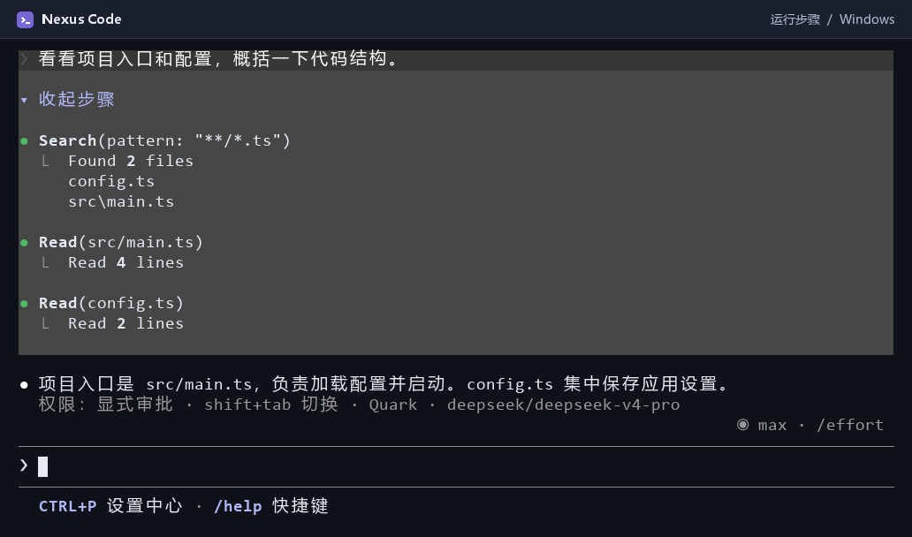
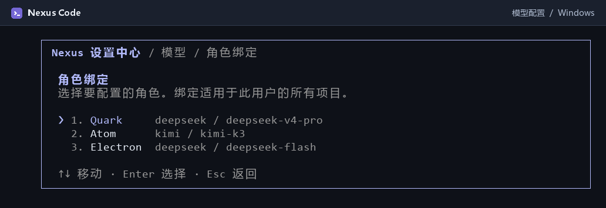

# Nexus Code

> 可在终端设置中心为三个模型角色分配渠道的 AI 编程助手。支持 DeepSeek、Messages 兼容服务和 OpenAI Chat Completions 兼容服务。



Windows 终端演示，使用示例项目与本地模拟渠道。

---

## ✨ 核心特色

### 🔧 多提供商 SDK 引擎

模型请求按角色选定的渠道读取服务地址、模型 ID 和凭据。内置 HTTP 客户端实现 Messages 协议，Chat Completions 使用 OpenAI 兼容适配器，两者共用 Nexus 的工具与会话编排。

Quark、Atom、Electron 是内核原生角色。命令隔离使用本地依赖 `@anthropic-ai/sandbox-runtime`。

### 🧠 多渠道思考模式

在「模型」→「推理偏好」切换思考，或用 `/effort` 调整强度。设置只列出当前模型支持的档位。终端可用 **Ctrl+O** 查看接口返回的可读思考内容。

| 官方渠道 | 思考开关 | 推理强度 |
|---|---|---|
| DeepSeek V4 Pro / Flash | Messages 和 Chat Completions 均可开关 | 低、高、最高 |
| GLM 5.2、5.1、5、4.7、4.6 | Chat Completions 可开关 | GLM 5.2 支持高、最高 |
| GLM 5.3 / Flash / FlashX | 始终思考 | Chat Completions 支持低、高、最高。Messages 使用服务端默认值 |
| Kimi K3 / K3.1 Pro | 始终思考 | Messages 和 Chat Completions 均支持低、高、最高 |
| MiMo V2.6 Flash / Pro / Pro Ultraspeed | Messages 和 Chat Completions 均可开关 | 使用模型默认强度 |

Nexus 根据已配置的渠道地址、协议和模型 ID 选择思考参数。中转站如果确认实现了某家厂商的参数，可在 `models.json` 对应模型条目中添加 `"reasoningDialect": "deepseek"`、`"glm"`、`"kimi"` 或 `"mimo"`。

### ⚛️ 三个可配置的模型角色

Quark、Atom、Electron 分别承接编排中原有的三个模型位置。每个位置都能选择自己的渠道和模型，也可以共用同一连接。要求继承主模型的子代理继续随父任务运行。

### 🛡️ 企业级 CICD
- 5 道 CI 门禁：gitleaks / 安装健康 / typecheck 基线 / 单元测试 / 漏洞基线
- main 分支保护 + strict checks + enforce_admins
- tag 一键发布 → GitHub Release 自动生成

### 🤖 自定义技能和子代理

可在项目的 `.nexus/skills/`、`.nexus/agents/` 或用户配置目录下添加技能和子代理。

### 🚀 全新用户引导
- 无 API key 时自动进入**配置表单**（输入服务地址 + 密钥），替代 OAuth 登录
- 完整中文化：欢迎页 / 信任对话框 / 安全提示 / 主题选择

### 📊 状态栏双色监控
```
🤖 Nexus Quark (1M context) 1M | ⚡️ 5.1% · 51.2k | 📈 11.8% · 118.4k
```
- 绿色模型名 + 上下文窗口 · 青色当前用量 · 橙色会话累计

### 🎨 视觉特色
- Neon 随机调色板 ASCII Art Logo（粒子主题）
- thinking 蓝色代码高亮（ANSI 34）
- AgentBar 状态条（子代理进度）

---

## 🚀 安装教程

### 0. 环境准备

**Linux / WSL2**，安装 [Bun](https://bun.sh)（≥1.3.5）：

```bash
curl -fsSL https://bun.sh/install | bash
# 重启终端或执行 source ~/.bashrc
bun --version   # 应输出 1.3.x
```

> ⚠️ 提示 `bun: command not found` 时，把 `~/.bun/bin` 加入 PATH：
> ```bash
> echo 'export PATH="$HOME/.bun/bin:$PATH"' >> ~/.bashrc && source ~/.bashrc
> ```

**Windows 原生**（v1.0.6 起支持），安装 bun：

```powershell
npm install -g bun
# 或: powershell -c "irm bun.sh/install.ps1 | iex"
bun --version   # 应输出 1.3.x
```

> ⚠️ npm 安装的 bun 可执行文件在 `%APPDATA%\npm\node_modules\bun\bin\bun.exe`，不在 PATH。
> 需要把以下两个目录加入系统 PATH（设置 → 系统 → 高级系统设置 → 环境变量）：
>
> ```
> %USERPROFILE%\.bun\bin
> %APPDATA%\npm\node_modules\bun\bin
> ```
>
> 或 PowerShell 一键添加（当前用户）：
> ```powershell
> setx PATH "$env:PATH;%USERPROFILE%\.bun\bin;%APPDATA%\npm\node_modules\bun\bin"
> ```
> 然后**重启终端**。启动器会自动定位 `bun.exe`（含 PATH 外常见安装位置探测），无需手动配置 `BUN_BINARY`。

### 1. 安装（3 步）

```bash
# 第 1 步：获取源码
git clone https://github.com/Whale-Talk/Nexus-Code.git ~/nexus
cd ~/nexus

# 第 2 步：安装依赖（约 15 秒）
bun install

# 第 3 步：全局注册 nexus 命令
bun link
```

验证：

```bash
nexus --version
```

### 2. 打开设置中心

Windows PowerShell 中，在本地源码目录运行以下命令即可启动当前工作副本。

```powershell
node .\bin\nexus.cjs
```

从 IDE 任务或自动化工具启动时，可以在源码目录用以下命令新建 Windows Terminal 窗口。

```powershell
wt -w new new-tab --reloadEnvironment -d "$PWD" node.exe .\bin\nexus.cjs
```

这样新窗口会加载用户环境，避免继承任务运行器的 `TERM=dumb` 或 `NO_COLOR=1` 而失去配色。如果渠道密钥仅设置在当前 PowerShell 进程中，请直接使用上面的 `node` 命令以沿用它。

在聊天输入框按 **Ctrl+P** 打开设置中心，也可使用 **F2** 或输入 `/settings`。用 **↑ / ↓** 移动，**Enter** 打开或修改选中项，**Esc** 返回上一层。通用设置与推理偏好中按 **Ctrl+S** 保存。查看快捷键时，输入 `/help` 并按 **Enter**。Windows Terminal 中也可点击底部的「快捷键」。半角 `?` 和全角 `？` 都是普通聊天文字，可单独发送。

| 想做什么 | 在设置中心的操作 |
|---|---|
| 查看三角色的实际绑定 | 「模型」→「角色绑定」，查看每个角色旁显示的渠道名和模型 ID |
| 修改一个角色 | 「模型」→「角色绑定」→ 选择角色、渠道与模型 → 保存绑定 |
| 接入另一家服务商 | 「模型」→「模型渠道」→「新增渠道」，填写名称、协议、接口地址，再添加模型并确认 |
| 修改已有服务的连接 | 「模型」→「模型渠道」→ 选择渠道，编辑协议、接口地址或凭据变量 |
| 给已有渠道补充模型 | 「模型」→「模型渠道」→ 选择渠道并添加模型，可读取列表或手工输入模型 ID |
| 输入或更新渠道密钥 | 「模型」→「渠道密钥」，核对地址，选择仅用于本次运行或保存到本机 |
| 修改思考等相关偏好 | 「模型」→「推理偏好」 |



角色绑定保存在用户配置目录的 `models.json`。同一窗口下次调用该角色就使用新的绑定；通过 `--model 渠道::模型` 指定具体模型的会话继续使用指定模型。`/model` 只在当前对话切换 Quark、Atom、Electron。打开、浏览或取消设置均不会迁移旧配置。Windows 默认配置目录为 `%USERPROFILE%\.nexus`，也可通过 `NEXUS_CONFIG_DIR` 为一次启动指定独立配置目录。

新增渠道时，窗口会建议一个密钥变量名，例如 `WORK_API_KEY`，回车即可采用。选择「从渠道读取模型列表」时，若变量尚未设置，窗口会显示目的地址并让你输入密钥。保存渠道后，该密钥可用于本次运行。需要下次启动也能使用时，在「渠道密钥」中选保存到本机。也可以直接沿用环境变量或原有 DeepSeek 单渠道的密钥。支持免密的本地 Chat Completions 服务可清空变量名。

例如，把 Electron 切到 DeepSeek Flash 时，在「模型」→「角色绑定」选中 Electron，再选择 DeepSeek 渠道和 `deepseek-flash`，保存后输入 `/model electron` 即可用于当前对话。列表里没有该模型时，可先到「模型渠道」读取列表，或手工输入服务商给出的完整模型 ID。读取列表返回 HTTP 401 时，可先手工添加模型，并在「渠道密钥」核对这条渠道的凭据。模型能否调用仍由服务商鉴权。

#### 终端操作

- **显示模式**从「通用设置与外观」→「终端显示模式」选择「自动」「全屏」或「经典」，按 **Ctrl+S** 保存后，下次启动生效。
- **运行步骤**在开启鼠标交互的全屏模式下，可点击运行摘要的「查看步骤」或「收起步骤」，查看读取文件、搜索和 Shell 命令等工具调用。也可用 **Ctrl+O** 切换详细视图。
- **复制文本**在全屏模式选中文本后可按 **Ctrl+C**。如果启用了「选中即复制」，松开鼠标就会复制。系统剪贴板确认后，输入框上方显示「已复制 N 个字符」。通过终端转发时会提示「已向终端发送复制请求」。
- **记忆文件**可在「更多设置」→「记忆文件」中打开项目或个人的 `NEXUS.md`，也可打开自动记忆目录。项目记忆随项目使用，个人记忆适用于本机各项目。

### 3. 已有单渠道配置

首次启动自动创建 `~/.nexus/settings.json`；或手动编辑（三角色完整配置）：

```json
{
  "env": {
    "NEXUS_BASE_URL": "https://api.deepseek.com/anthropic",
    "NEXUS_API_KEY": "你的 DeepSeek API 密钥",
    "NEXUS_PROVIDER": "messages",
    "NEXUS_MODEL": "deepseek-v4-pro",
    "NEXUS_QUARK_MODEL": "deepseek-v4-pro",
    "NEXUS_ATOM_MODEL": "deepseek-flash",
    "NEXUS_ELECTRON_MODEL": "deepseek-flash"
  },
  "model": "deepseek-v4-pro"
}
```

仅配置 `NEXUS_MODEL` 时三个角色均沿用它。首次进入设置中心会按现有连接预览，保存后才建立多渠道配置。需要更新旧连接的密钥可使用 `/nexus-config`。

### 4. 常用命令

| 操作 | 命令 |
|------|------|
| 启动 | `nexus` |
| 查看版本 | `nexus --version` |
| 指定模型 | `nexus --model deepseek-flash` |
| 继续上次对话 | `nexus -c` |
| 恢复指定会话 | `nexus -r` |
| 对话中切换角色 | `/model` 或 `/model quark`、`/model atom`、`/model electron` |
| 打开设置中心 | `Ctrl+P`、`F2` 或 `/settings` |
| 配置角色绑定 | 设置中心 → 模型 → 角色绑定 |
| 查看文件变更 | `/diff` |

正常启动默认使用工具审批流程。对话中按 **Shift+Tab** 切换权限模式。接受编辑会自动批准可编辑范围内的文件操作，其他工具仍按审批规则执行。计划模式允许只读操作、提问和编辑当前计划文件，修改或构建项目需要先退出计划模式。「不询问」会拒绝需要临时确认的操作。需要绕过工具确认时，可显式启动 `nexus --permission-mode bypassPermissions`。命令沙箱单独配置。

### 配置三个模型角色

在 Nexus 配置目录下添加 `models.json`，可以给 Quark、Atom、Electron 分别选择渠道与模型。主会话和代理直接使用这三个角色。子代理原有的选角和 `inherit` 行为照常工作。

```json
{
  "roles": {
    "quark": "deepseek::deepseek-v4-pro",
    "atom": "coding::coding-main",
    "electron": "deepseek::deepseek-flash"
  },
  "channels": {
    "deepseek": {
      "protocol": "messages",
      "baseURL": "https://api.deepseek.com/anthropic",
      "apiKeyEnv": "DEEPSEEK_API_KEY",
      "models": [
        { "id": "deepseek-v4-pro", "contextWindow": 1000000 },
        { "id": "deepseek-flash", "contextWindow": 1000000 }
      ]
    },
    "coding": {
      "protocol": "openai-compatible",
      "baseURL": "https://relay.example.com/v1",
      "apiKeyEnv": "CODING_RELAY_API_KEY",
      "models": [{ "id": "coding-main", "contextWindow": 128000, "maxOutputTokens": 8192 }]
    }
  }
}
```

每个物理模型可单独设置 `contextWindow`、`maxOutputTokens`、`capabilities` 和 `pricing`。例如，同名模型在两个渠道上的上下文长度、推理支持和价格可以不同。未配置价格时只统计用量。输入、输出和缓存价格均以美元／百万 token 计，网络搜索以美元／次计。

已有 Nexus 配置目录升级时，启动器将旧 Messages 协议设置写成 `messages`，并将原来的用户偏好复制到 `profile.json`。它保留会话文件和用户填写的模型 ID。环境变量请使用 `NEXUS_*`，角色可直接填写 `quark`、`atom`、`electron` 或在代理中指定 `inherit`。

按渠道的实际地址和模型 ID 填写，并在启动 Nexus 的环境里设置 `apiKeyEnv` 指定的变量。同名模型可在多个渠道注册，命令行通过完整的 `--model channel::model` 消除歧义。手工编辑文件或修改外部环境变量后，重新启动 Nexus 以载入改动。

可以把任一角色绑定到 Claude。使用 Anthropic 官方 API 时，在「模型渠道」选择 Messages、填写 `https://api.anthropic.com`、该账户可用的模型 ID 及独立密钥变量；使用中转服务时填写中转地址。

`WebSearch` 和 `WebFetch` 使用工具审批。在设置中心的「网页工具」可分别选择搜索和读取，并设置 DeepSeek 网页共享密钥 `DEEPSEEK_WEB_API_KEY`。

| 设置 | 选项 | 自动模式 |
|------|------|----------|
| `NEXUS_SEARCH_PROVIDER` | `auto`（默认）、`deepseek`、`exa`、`parallel` | 官方 DeepSeek 渠道或独立网页密钥可用时使用 DeepSeek Search API，其余情况使用 Exa |
| `NEXUS_FETCH_PROVIDER` | `auto`（默认）、`deepseek`、`direct` | 官方 DeepSeek 渠道或独立网页密钥可用时使用 DeepSeek Fetch API，其余情况直接读取网址 |

DeepSeek 搜索和读取分别优先使用 `DEEPSEEK_SEARCH_API_KEY`、`DEEPSEEK_FETCH_API_KEY`，其次使用共享网页密钥。仅当发起这次工具调用的推理请求实际发往 DeepSeek 官方地址时，才可使用该渠道密钥。例如 Claude 或本地模型使用共享网页密钥即可在自动模式下调用 DeepSeek 搜索和读取。Exa 和 Parallel 分别读取 `EXA_API_KEY` 与 `PARALLEL_API_KEY`。

独立 Search 和 Fetch API 按有效的成功请求计费。DeepSeek 搜索词连同域名限制最多为 128 个字符。读取公开网址时，DeepSeek 返回 Markdown，由发起工具调用的模型处理。直接读取可继续处理重定向和本地保存二进制附件。选择的搜索或读取服务报错时，工具把错误返回给调用方。[DeepSeek 搜索与读取指南](https://api-docs.deepseek.com/guides/search/#billing)

可用 `NEXUS_WEB_FETCH_POLICY_URL` 检查读取的目标域名。Nexus 发送带 `domain` 参数的 GET 请求，并读取响应的 `can_fetch`。DeepSeek Fetch API 响应提供标题和内容，直接读取能显示跨站重定向及目标状态。[DeepSeek Fetch API 响应](https://api-docs.deepseek.com/api/fetch/)

### 5. 升级

```bash
cd ~/nexus
git pull origin main
bun install
nexus --version   # 确认版本号变化
```

> 会话历史与配置在 `~/.nexus/`，升级不影响任何数据。

### 6. 常见问题

| 问题 | 解决 |
|------|------|
| `nexus: command not found` | `~/.bun/bin`（Windows: `%USERPROFILE%\.bun\bin`）不在 PATH，见步骤 0 |
| 启动报 `bun: command not found` | Bun 未安装，见步骤 0 |
| Windows 报 `spawn bun ENOENT` | npm 装 bun 的可执行文件不在 PATH，见步骤 0 的 Windows 说明 |
| 401 / 身份验证失败 | 核对该渠道的接口地址与密钥是否配对，使用服务商发放的完整密钥 |
| 403 | Token 失效，联系管理员 |
| 回复很慢 | 高峰期限流，切 `--model electron` |

---

## 📁 项目结构

```
src/                        # 核心源码
├── services/api/provider/  # Provider 抽象层（types/errors/adapters）
├── tools/                  # 53 个工具（Bash/FileEdit/Agent/MCP...）
├── commands/               # 斜杠命令（含 /nexus-config）
├── services/               # API / MCP / analytics
├── components/             # 终端 UI 组件（React + Ink）
├── skills/                 # 技能加载与内置技能
└── ...
bin/nexus.cjs               # 启动器（配置隔离 + 环境桥接）
.github/                    # CI/CD（5 门禁 + release 自动化）
```

---

## 📊 关键数据

| 指标 | 值 |
|------|-----|
| 运行时 | Bun 1.3.14, TypeScript ESM |
| AI SDK | 原生 Messages HTTP/SSE + ai@7.0.58 + @ai-sdk/openai-compatible@3.0.27 |
| typecheck | 检查新增错误签名 |
| 分支保护 | 5 checks required |
